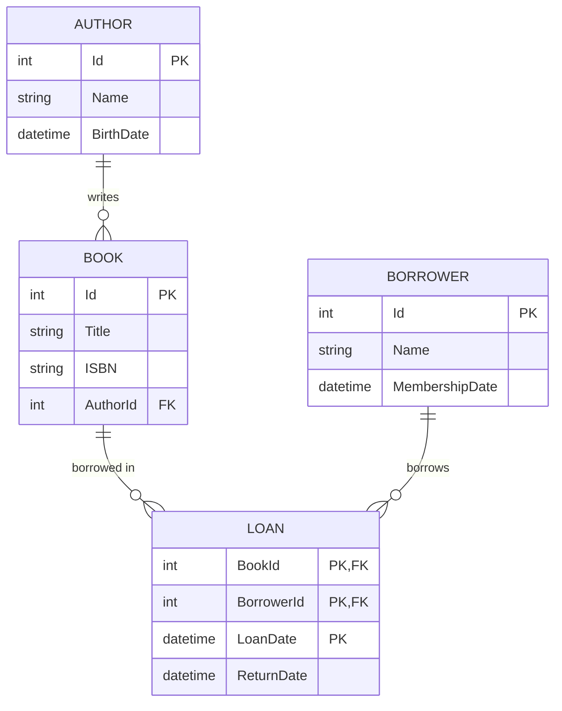

# Library System Web API

This project provides full asynchronous CRUD (Create, Read All, Read by ID, Update, Delete) RESTful endpoints for all entities in the **Library System** using Entity Framework Core, DTOs, and ASP.NET Core Web API.

---

## 1. Solution Architecture
- **Framework:** .NET 10.0 / ASP.NET Core Web API
- **ORM:** Entity Framework Core (SQL Server)
- **Data Transfer Objects (DTOs):** Separate models for Input (`Create*Dto`, `Update*Dto`) and Output (`*Dto`, `*SummaryDto`).
- **Asynchronous Programming:** All database interactions leverage `async`/`await` (`ToListAsync`, `FirstOrDefaultAsync`, `AddAsync`, `SaveChangesAsync`, etc.).
- **Interactive Documentation:** Swagger UI / OpenAPI enabled.

---

## 2. Entities & Endpoints

### 1. Authors (`/api/Authors`)
- `GET /api/Authors` - Get all authors with their associated books summary.
- `GET /api/Authors/{id}` - Get author by ID with book details.
- `POST /api/Authors` - Create new author (`CreateAuthorDto`).
- `PUT /api/Authors/{id}` - Update author (`UpdateAuthorDto`).
- `DELETE /api/Authors/{id}` - Delete author by ID.

### 2. Books (`/api/Books`)
- `GET /api/Books` - Get all books with author details.
- `GET /api/Books/{id}` - Get book by ID.
- `POST /api/Books` - Create new book with author association (`CreateBookDto`).
- `PUT /api/Books/{id}` - Update book details and author (`UpdateBookDto`).
- `DELETE /api/Books/{id}` - Delete book by ID.

### 3. Borrowers (`/api/Borrowers`)
- `GET /api/Borrowers` - Get all borrowers with their loan records.
- `GET /api/Borrowers/{id}` - Get borrower by ID.
- `POST /api/Borrowers` - Create new borrower (`CreateBorrowerDto`).
- `PUT /api/Borrowers/{id}` - Update borrower (`UpdateBorrowerDto`).
- `DELETE /api/Borrowers/{id}` - Delete borrower by ID.

### 4. Loans (`/api/Loans`)
- `GET /api/Loans` - Get all loans with book titles and borrower names.
- `GET /api/Loans/{bookId}/{borrowerId}/{loanDate}` - Get loan by composite key.
- `POST /api/Loans` - Create new loan with book and borrower validation (`CreateLoanDto`).
- `PUT /api/Loans/{bookId}/{borrowerId}/{loanDate}` - Update return date (`UpdateLoanDto`).
- `DELETE /api/Loans/{bookId}/{borrowerId}/{loanDate}` - Delete loan record.

---

## 3. Database ERD

